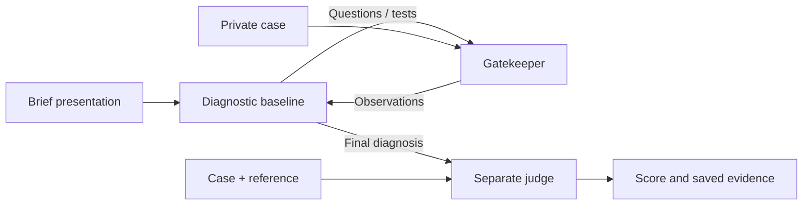

# SDBench in Harbor

Run Microsoft's released SDBench diagnostic baseline in Harbor with separate
case access, verifiable encounter artifacts and a paired gatekeeper experiment.
The diagnostic agent asks questions and orders tests; the gatekeeper supplies
observations; a separate judge scores the final diagnosis against the reference.



We reuse SDBench's baseline, TestRunner, clinical prompts, judge and HTML
renderer. Harbor handles environments, scheduling, artifact collection and ATIF
trajectories. The adapter adds the role boundary, metered provider calls and
paired analysis. These are three containers on a shared host kernel; semantic
disclosure still needs evaluation.

**Original MAI-DxO is not included.** The earlier paper-inspired panel was removed
because it was outside this project's baseline study. See [upstream sources](docs/SOURCES.md).
The retained Langfuse exporter sends API metadata only; it does not add a clinical
evaluator or change the diagnostic workflow.

## Run a fictional smoke test

Requires Docker, [uv](https://docs.astral.sh/uv/) and Python 3.12 for Harbor 0.24.
Core SDBench and role images support Python 3.11. From the repository root:

```bash
uv sync --python 3.12 --extra harbor

uv run --extra harbor python -m sdbench.cli.isolation prepare \
  --dataset synthetic --case-set train \
  --max-turns 5 --max-model-calls 12 \
  --api-mode mock --output results/harbor-smoke

uv run --extra harbor harbor run --config results/harbor-smoke/job.json

uv run --extra harbor python -m sdbench.cli.isolation summarize \
  --manifest results/harbor-smoke/manifest.json \
  --jobs results/harbor-smoke/jobs --output results/harbor-smoke/summary.json

uv run --extra harbor harbor view results/harbor-smoke/jobs \
  --host 127.0.0.1 --port 8080-8089 --jobs
```

Five fictional cases × two mock conditions give ten encounters and no model
API calls. The mock judge deliberately returns 3/5 and reward 0. Completion is
an execution check, not diagnostic accuracy. Use a new output path when repeating.

Open a trial to see its text trajectory. The evaluator's clinical report contains
all role conversations and the reference. There is no screen video. Unknown API
cost can leave Harbor's Pareto plot empty. Use time, or tokens when usage was recorded.

## Scope

| Working capability | Boundary |
| --- | --- |
| Released baseline through Harbor | Scripted transport parity and mock container checks; see verification |
| Paired `o4-mini` / `gpt-5` gatekeeper schedule | Direct OpenAI; live comparison not run |
| Azure Responses and refreshed credentials | Separate single-model fictional smoke route |
| Native trajectory, clinical report, usage ledger | Recorded model flags are not independently verified source evidence |
| Optional Langfuse export | Post-run metadata; no clinical text or reconstructed execution waterfall |

The planned study uses diagnostic episodes from longitudinal myeloma records.
**No real patient has been evaluated.** Custom episode preparation, recorded-only
evidence retrieval, one-shot comparisons and episode-specific evaluators remain
unimplemented. The current paired CLI accepts only `synthetic`, `nejm` and `mimic`.

The released judge assesses clinical meaning and specificity, not keywords, but
can count omitted qualifiers as correct at 4/5. A staging or progression endpoint
needs a separately declared rubric. Estimated medical-workup cost, token-rate API
estimates and invoiced charges are separate quantities; Harbor does not yet run
clinical costing or reconcile invoices.

## Guides

- [Harbor](docs/HARBOR_EXPERIMENT.md): source map, role boundaries, live commands, reports and tracing.
- [Stock SDBench](RUN_SDBENCH.md): original runner, provider configuration and clinical costing.
- [Study plan](docs/STUDY_PROTOCOL.md): proposed episodes and comparisons, separate from implemented code.
- [Verification](docs/VERIFICATION.md): checks actually run and their limits.
- [Cleanup tickets](https://github.com/Ali-Maq/sdbench/issues/2): file decisions and completion evidence.

Five fictional cases are bundled. [NEJM](data/processed_case_data/nejm/README.md)
and [MIMIC](data/processed_case_data/mimic/README.md) require their respective access
permissions. The stock [case loader](sdbench/case_data.py) accepts custom datasets;
a full longitudinal chart still needs episode preparation. Generated tasks,
images and reports can contain the private case and belong outside source control.

```bash
uv sync --python 3.12 --extra harbor --extra tracing
uv run python -m unittest discover -s tests -v
uv build
```

## Credit and license

SDBench is authored by Microsoft and distributed under the [MIT License](LICENSE). This fork's Harbor adapter is an independent extension; it does not imply Microsoft endorsement. Dataset licenses and access conditions are separate from the code license.

## Citation

If you use SDBench, please cite the Science article:

```bibtex
@article{nori2026sequentialdiagnosislanguagemodels,
  title={Sequential Diagnosis with Language Models},
  author={Harsha Nori and Mayank Daswani and Christopher Kelly and Scott Lundberg and
          Marco Tulio Ribeiro and Marc Wilson and Xiaoxuan Liu and Viknesh Sounderajah and
          Jonathan Carlson and Matthew P Lungren and Bay Gross and Peter Hames and
          Mustafa Suleyman and Dominic King and Eric Horvitz},
  journal={Science},
  year={2026},
  doi={10.1126/science.aeh7930},
  url={https://www.science.org/doi/10.1126/science.aeh7930},
}
```
