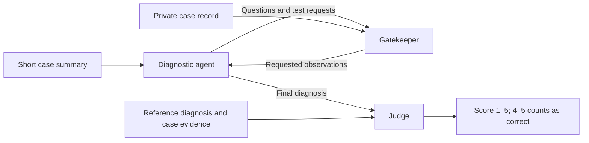

# SDBench with Harbor

A research fork of Microsoft's **Sequential Diagnosis Benchmark (SDBench)**, with a Harbor adapter for running, inspecting, and comparing diagnostic-agent encounters.

The adapter reuses the **released SDBench baseline, gatekeeper, and judge**. It adds role-separated execution, a native Harbor trajectory, protected evaluation evidence, and a paired experiment that changes the gatekeeper from `o4-mini` to `gpt-5`.

**This repository does not contain the original MAI-DxO orchestrator.** The official repository, paper-linked archive, and supplementary methods were checked; see the [source audit](docs/mai_dxo_source_audit.json). An optional experimental panel is a separately labeled, paper-inspired implementation, not Microsoft's original code or a reproduction of the paper's results. See [agent extensions](docs/AGENT_EXTENSIONS.md).

[Original Microsoft repository](https://github.com/microsoft/sdbench) · [Science paper](https://www.science.org/doi/10.1126/science.aeh7930) · [Official benchmark website](https://microsoft.github.io/sdbench) · [Harbor guide](docs/HARBOR_EXPERIMENT.md)

The [verification record](docs/VERIFICATION.md) reports the actual tests, including an incorrect live synthetic result, and the remaining research work.

## What happens in an encounter?

The diagnostic agent starts with a short patient presentation. It asks questions or orders tests, receives observations from the gatekeeper, and eventually submits a diagnosis. The judge then scores that answer against the reference diagnosis.



These are different responsibilities, not three clinicians deliberating together. The gatekeeper supplies information during the encounter; the judge evaluates the final answer afterward. The stock gatekeeper can generate a synthetic finding when the case lacks a requested result. A “recorded evidence only” policy would be a separate experimental variant.

**MAI-DxO** is the diagnostic strategy described in the paper: a model simulates a physician panel to discuss hypotheses, tests, objections, costs, and omissions. That panel belongs *inside* the diagnostic-agent box. Five role names alone do not make a faithful implementation of the original system.

## Choose a workflow

| Goal | Use | What it gives you |
| --- | --- | --- |
| Run the released benchmark harness | [Stock SDBench commands](#run-the-released-sdbench-harness) | Sequential diagnosis, scoring, clinical-workup costing, and existing HTML reports |
| Check Harbor without model API calls | [Mock quickstart](#try-harbor-without-model-api-calls) | Container execution, evidence transfer, scoring plumbing, and native trajectories |
| Inspect a live model on a fictional case | [Azure smoke test](docs/HARBOR_EXPERIMENT.md#live-azure-smoke-test) | One bounded encounter, per-attempt usage, and a clinical report |
| Compare only the gatekeeper model | [Paired experiment](docs/HARBOR_EXPERIMENT.md#paired-experiment-design) | Matched case/repetition pairs, failure accounting, and usage by arm |
| Explore panel orchestration | [Agent extensions](docs/AGENT_EXTENSIONS.md) | An opt-in experimental policy; not original MAI-DxO |

Harbor provides execution, scheduling, a separate verifier, artifact collection, and a common trajectory format. SDBench already has a parallel, resumable harness; the purpose of this adapter is a reusable evaluation boundary and inspectable evidence.

The adapter uses **three role containers on a shared host kernel**: diagnosis and a gatekeeper sidecar run together; Harbor starts a separate judge/verifier afterward. These are not three independent virtual machines. Native Codex/Claude Code clinical tools are not connected to these tasks.

## Try Harbor without model API calls

Requires [uv](https://docs.astral.sh/uv/), Docker, and Python 3.12 for Harbor. Core SDBench and the role containers remain compatible with Python 3.11.

```bash
uv sync --python 3.12 --extra harbor

uv run --extra harbor python -m sdbench.cli.isolation prepare \
  --dataset synthetic --case-set train \
  --max-turns 5 --max-model-calls 12 \
  --api-mode mock --output results/harbor-smoke

uv run --extra harbor harbor run --config results/harbor-smoke/job.json

uv run --extra harbor python -m sdbench.cli.isolation summarize \
  --manifest results/harbor-smoke/manifest.json \
  --jobs results/harbor-smoke/jobs \
  --output results/harbor-smoke/summary.json

uv run --extra harbor harbor view results/harbor-smoke/jobs \
  --host 127.0.0.1 --port 8080-8089 --jobs
```

This prepares five fictional cases × two gatekeeper conditions: **ten mock encounters and no model API calls**. A healthy baseline mock run completes all ten encounters with score 3 and reward 0 by design. Those values test execution; they do not measure medical accuracy. Preparation refuses to overwrite an existing directory, so choose a new output path when repeating it.

Open a job and then a trial in Harbor to see the diagnostic trajectory and verifier result. This is a text/action record, not a video. The adapter also reuses SDBench's HTML renderer to show diagnostic, gatekeeper, and judge conversations together. See [viewing results and reports](docs/HARBOR_EXPERIMENT.md#viewing-results-and-reports).

## Run the released SDBench harness

The commands below use SDBench's own runner, without Harbor. Model calls incur provider charges.

```bash
uv sync
```

Provide credentials through your environment or a local `.env` file; the CLI loads `.env` automatically. For an agent-assisted setup, follow [RUN_SDBENCH.md](RUN_SDBENCH.md).

```bash
# Inspect available cases and splits.
uv run python -m sdbench.cli.case_data synthetic --list-only

# Run one fictional case with the baseline.
uv run python -m sdbench.cli.agent synthetic 0 --agent baseline --model <model>

# Run the synthetic training set.
uv run python -m sdbench.cli.harness \
  --dataset synthetic --case-set train --agent baseline --model <model>

# Resume a saved harness run.
uv run python -m sdbench.cli.harness --resume <results-directory>

# Full flag reference.
uv run python -m sdbench.cli.harness --help
```

Use `--case-id <id> [<id> ...]` or `--num-cases N` to select a subset, and `--max-workers N` to control parallelism.

### Model providers & environment variables

The stock harness routes calls through [`models.py`](sdbench/models.py). The Harbor adapter has a narrower, metered provider path; stock routing settings do not automatically apply to Harbor.

| Variable | Purpose |
| --- | --- |
| `OPENROUTER_API_KEY` | Credentials for the default OpenRouter route |
| `SDBENCH_FORCE_AZURE=1` | Route stock-harness calls through Azure OpenAI |
| `AZURE_OPENAI_API_KEY`, `AZURE_OPENAI_ENDPOINT`, `AZURE_OPENAI_API_VERSION` | Azure credentials and API settings |
| `SDBENCH_OPENROUTER_ZDR_ONLY=0` | Permit non-zero-data-retention providers when the dataset permits |
| `SDBENCH_LOCAL_BASE_URL`, `SDBENCH_LOCAL_API_KEY`, `SDBENCH_LOCAL_HEADERS` | Endpoint, optional key, and JSON headers for models named `local-...` |
| `SDBENCH_DATA_PATH` | Data root; defaults to `./data` |
| `SDBENCH_LOCAL_DIR` | Local prompt/agent/config override root; defaults to the current directory. Set to `disable` to use packaged definitions only |
| `OPENAI_API_KEY` | Stock CPT-costing embedding fallback when OpenRouter is unset; also the separate Harbor adapter's direct OpenAI credential |

For local inference, the full model name, including `local-`, is sent to the server. The default local API key is the placeholder `sk-local`; `SDBENCH_LOCAL_HEADERS` accepts JSON headers and overrides that authorization header when supplied.

```bash
export SDBENCH_LOCAL_BASE_URL=http://localhost:8000/v1
uv run python -m sdbench.cli.harness --model local-my-model
```

For Azure, `--model` normally identifies the deployment name; a few legacy aliases are mapped in `models.py`:

```bash
export SDBENCH_FORCE_AZURE=1
uv run python -m sdbench.cli.harness --model <azure-deployment>
```

`--model-args` accepts a JSON object merged into diagnostic-model calls:

```bash
uv run python -m sdbench.cli.harness --model <model> \
  --model-args '{"reasoning_effort": "high"}'
```

Routing overrides `force_azure`, `openrouter_zdr_only`, `local_model_base_url`, `local_model_api_key`, and `local_model_headers` are intercepted rather than sent as generation arguments. When importing SDBench as a library, load environment variables yourself; only the CLI loads `.env` automatically. Library callers should also choose an explicit local-override directory or set `SDBENCH_LOCAL_DIR=disable`.

### Published baseline configuration

Named configurations in [`config.py`](sdbench/config.py) pin the gatekeeper and judge:

| Configuration | Use |
| --- | --- |
| `default` | Current defaults; NEJM-style gatekeeper for synthetic and other non-MIMIC datasets |
| `science` | Published baseline settings for `nejm` and `mimic`; not an MAI-DxO implementation |

To evaluate a baseline with the published configuration, obtain the corresponding dataset and use its `validationandtest` split:

```bash
uv run python -m sdbench.cli.harness \
  --dataset <nejm-or-mimic> --case-set validationandtest \
  --agent baseline --sdbench-config science --model <model>
```

Matching a configuration alone does not reproduce a result: the dataset/split, model version, provider settings, and costing method also matter.

## Data

| Dataset | Availability | Intended use |
| --- | --- | --- |
| `synthetic` | Five fictional cases included; `train` split | Development and integration checks |
| `nejm` | [Separate NEJM access/license](data/processed_case_data/nejm/README.md) | Clinically sourced benchmark evaluation |
| `mimic` | [MIMIC-IV-Ext-SDBench on PhysioNet](https://physionet.org/content/mimic-iv-ext-sdbench/1.0.0/), subject to its access conditions | Clinically sourced benchmark evaluation |

The stock harness supports custom datasets under `data/processed_case_data/<dataset>/`; the schema is documented in [`case_data.py`](sdbench/case_data.py). A case needs a short initial presentation, private case evidence, and a reference diagnosis. Preparing an encounter from a longitudinal record also requires an explicit starting point and a reviewed answer. The opening summary must not give the diagnostician future information.

The paired Harbor CLI currently accepts only `synthetic`, `nejm`, and `mimic`; its Azure smoke command deliberately accepts only bundled synthetic cases. Custom patient preparation is not a turnkey feature of those commands. Evaluate the gatekeeper on any new case format; upstream provides different NEJM and MIMIC prompt families.

Generated Harbor tasks, images, reports, and raw-call ledgers can contain the full case. Keep them within the dataset's permitted research environment. Access to a cloud model does not by itself establish that the dataset may be sent there.

## Costs and results

Keep three quantities separate:

| Quantity | Meaning | Current Harbor status |
| --- | --- | --- |
| Clinical-workup cost | Estimated cost of ordered medical tests and visits | SDBench's costing is available, but the adapter does not execute it |
| API cost estimate | Provider-reported token usage × an applicable rate card | Usage recorded per attempt; estimates require supplied rates |
| Actual API charges | Amount charged by the provider | Not reconciled; `actual_paid_usd` remains unknown |

Harbor's Pareto view is normally API cost versus reward. It is not the paper's clinical-workup cost plot. Unknown API cost may leave that plot empty; choose tokens or time to inspect a smoke run. Catalog-price tooltips are not provider invoices.

### Stock-harness clinical costing

The stock harness defaults to LLM-estimated test costs using `gpt-5-mini` (overridable with `--costing-model`). Use `--no-compute-costs` to skip costing. For the paper's grounded method, configure the public hospital charge master as described in [costing data setup](data/costing_data/README.md), then run:

```bash
uv run --extra cpt_costing python -m sdbench.cli.recost <results-directory>
```

This writes costs back to the case results and reports CPT-grounded matches versus LLM fallbacks. Review that coverage before comparing costs. LLM-only estimates and grounded estimates are different measurements.

```bash
# Recompute already priced cases.
uv run --extra cpt_costing python -m sdbench.cli.recost <results-directory> --force

# Inspect existing costing coverage without recomputing.
uv run --extra cpt_costing python -m sdbench.cli.recost <results-directory> --analyze-only

# Use LLM-only costing.
uv run python -m sdbench.cli.recost <results-directory> --costing-method llm_only
```

Grounded costing can also run inline with `--costing-method unified_cpt_llm`. The optional `azure` extra supports Blob output and a CosmosDB costing cache. Install extras with `uv sync --extra <name>` or `uv sync --all-extras`; consult CLI `--help` and [RUN_SDBENCH.md](RUN_SDBENCH.md) for cache and managed-identity settings.

### Stock-harness reports

Each run saves case JSON, HTML, a summary, and `run_config.json` under `results/`. Regenerate reports from saved outputs without rerunning diagnosis:

```bash
uv run python -m sdbench.cli.reporting <results-directory> --ci --json report.json
```

The reporter also accepts multiple result directories from the same dataset. It groups by `(agent, model)` and reports accuracy and each available costing method. The stock reporter excludes errored/incomplete cases from accuracy and flags them. The paired Harbor analysis instead counts missing/failed scheduled attempts as incorrect in its primary accuracy, while also reporting completed-only accuracy. State the denominator when comparing results.

## Extend and verify

The upstream [`DiagnosticAgent` protocol](sdbench/agents/__init__.py) defines:

```python
run(case_summary, test_runner, agent_llm, collector, config)
```

For the stock harness, put a module under `diagnostic_agents/` in the local-override directory and select it with `--agent <module>`. The [baseline](sdbench/agents/baseline.py) demonstrates XML-tagged questions, tests, and final diagnoses. See [agent extensions](docs/AGENT_EXTENSIONS.md) for the optional experimental panel and tracing scope.

```bash
# Core compatibility and tests.
uv run --python 3.11 python -m compileall -q sdbench
uv run --python 3.11 python -m unittest discover -s tests -v

# Include Harbor schema/adapter checks.
uv run --python 3.12 --extra harbor python -m unittest discover -s tests -v
```

See the [Harbor architecture and experiment guide](docs/HARBOR_EXPERIMENT.md) for the source map, role boundaries, deliberate deviations, and remaining work.

## Credit and license

SDBench is authored by Microsoft and distributed under the [MIT License](LICENSE). This fork's Harbor adapter is an independent extension; it does not imply Microsoft endorsement. Dataset licenses and access conditions are separate from the code license.

## Citation

If you use SDBench, please cite the Science article:

```bibtex
@article{nori2026sequentialdiagnosislanguagemodels,
  title={Sequential Diagnosis with Language Models},
  author={Harsha Nori and Mayank Daswani and Christopher Kelly and Scott Lundberg and
          Marco Tulio Ribeiro and Marc Wilson and Xiaoxuan Liu and Viknesh Sounderajah and
          Jonathan Carlson and Matthew P Lungren and Bay Gross and Peter Hames and
          Mustafa Suleyman and Dominic King and Eric Horvitz},
  journal={Science},
  year={2026},
  doi={10.1126/science.aeh7930},
  url={https://www.science.org/doi/10.1126/science.aeh7930},
}
```
