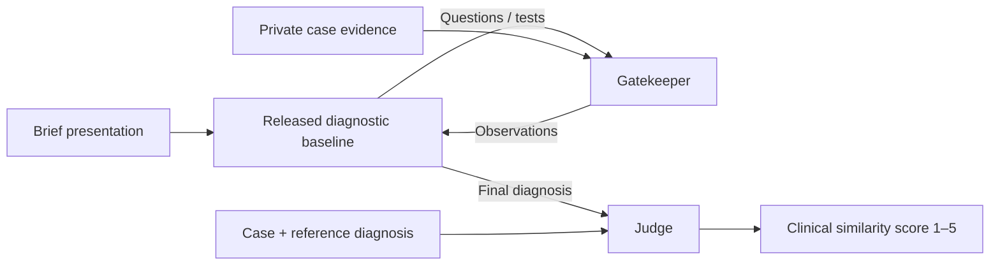

# SDBench in Harbor

Run Microsoft's released sequential diagnostic baseline in Harbor, inspect the
encounter, and measure how changing its information gatekeeper affects the result.

Our research goal is to evaluate this workflow on diagnostic episodes extracted
from longitudinal multiple-myeloma records. **That study has not run.** The current
implementation has been exercised on fictional cases; custom longitudinal episode
preparation, one-shot comparisons and clinical evaluation remain to be built.
The [study plan](docs/STUDY_PROTOCOL.md) defines those boundaries and comparisons.

**Original MAI-DxO is not included.** Microsoft's public release supplies SDBench's
baseline, gatekeeper, judge and costing code. The optional `experimental_panel`
is a separately written exploration, outside the primary study. It cannot reproduce
the original MAI-DxO result. See the [source audit](docs/mai_dxo_source_audit.json).

[Upstream repository](https://github.com/microsoft/sdbench) ·
[Science paper](https://www.science.org/doi/10.1126/science.aeh7930) ·
[Verification record](docs/VERIFICATION.md)

## What the code does



The judge assesses clinical meaning, specificity and incorrect additions; it is
not a keyword matcher. SDBench counts scores 4–5 as correct. Some omitted qualifiers
can still receive 4, so that outcome alone cannot establish accurate disease staging
or progression assessment. Those need explicit episode-specific endpoints.

Harbor runs the diagnostic client and a trusted gatekeeper sidecar, collects the
sidecar's evidence, then runs a separate verifier. These are **three containers
sharing the host kernel**. The diagnostic client cannot read the private case or
reference files. Textual disclosure by the gatekeeper still needs evaluation.

We reuse SDBench's diagnostic loop, prompts, TestRunner, judge and HTML renderer;
Harbor provides scheduling, environments, artifacts and its ATIF trajectory viewer.
The adapter adds the role boundary, metered provider calls and paired analysis.
The [architecture guide](docs/HARBOR_EXPERIMENT.md#architecture) maps each part to code.

## Current status

| Capability | Status |
| --- | --- |
| Released baseline in Harbor | Ten mock encounters completed; see verification record |
| Paired `o4-mini` / `gpt-5` gatekeeper schedule | Implemented for direct OpenAI; live comparison not run |
| Azure Responses API, per-attempt usage, native trajectory and clinical report | Earlier baseline and panel smoke runs on fictional data; not a controlled comparison |
| Optional experimental panel | Separate policy; live fictional example scored **2/5**, incorrect |
| Langfuse | Optional post-run API metadata export; no clinical dialogue or evaluator ensemble |
| Real longitudinal patient evaluation | Not run; no custom cohort support in the paired CLI |
| Clinical-workup cost in Harbor / invoiced API charges | Not calculated / not reconciled |

## Try Harbor without model API calls

Requires Docker, [uv](https://docs.astral.sh/uv/) and Python 3.12 for Harbor 0.24.0.
Core SDBench and role images support Python 3.11. Run from the repository root:

```bash
uv sync --python 3.12 --extra harbor

uv run --extra harbor python -m sdbench.cli.isolation prepare \
  --dataset synthetic --case-set train \
  --max-turns 5 --max-model-calls 12 \
  --api-mode mock --output results/harbor-smoke

uv run --extra harbor harbor run --config results/harbor-smoke/job.json

uv run --extra harbor python -m sdbench.cli.isolation summarize \
  --manifest results/harbor-smoke/manifest.json \
  --jobs results/harbor-smoke/jobs \
  --output results/harbor-smoke/summary.json

uv run --extra harbor harbor view results/harbor-smoke/jobs \
  --host 127.0.0.1 --port 8080-8089 --jobs
```

This runs five fictional cases under two mock conditions. The mock judge returns
3/5 and reward 0 deliberately; completion tests execution, not medical accuracy.
Preparation refuses to overwrite an existing directory. Choose a new path to repeat.

Open a trial to inspect messages, requests and observations. This is a text trace;
there is no screen video. Full role conversations and the reference belong in the
evaluator's [clinical report](docs/HARBOR_EXPERIMENT.md#viewing-results-and-reports).
Unknown API dollars can leave Harbor's cost-versus-reward plot empty; use tokens
or time. That plot is not the paper's medical-workup cost frontier.

## Documentation

| Question | Guide |
| --- | --- |
| What study are we proposing, and what can it establish? | [Study protocol](docs/STUDY_PROTOCOL.md) |
| How are roles isolated, live calls run and paired results analyzed? | [Harbor architecture and commands](docs/HARBOR_EXPERIMENT.md) |
| How do I use the original harness, providers and clinical costing? | [Stock harness](docs/STOCK_HARNESS.md), [runbook](RUN_SDBENCH.md) |
| What are the optional panel and Langfuse exporter? | [Extensions](docs/AGENT_EXTENSIONS.md) |
| What has actually been tested? | [Verification](docs/VERIFICATION.md) |

## Data and contributions

Five fictional cases are bundled. Real [NEJM](data/processed_case_data/nejm/README.md)
and [MIMIC](data/processed_case_data/mimic/README.md) cases require their respective
access permissions. The stock [case loader](sdbench/case_data.py) supports custom
datasets, but the paired Harbor CLI currently accepts only `synthetic`, `nejm`
and `mimic`. A full longitudinal chart is not a prepared diagnostic episode.

Generated tasks, images and reports can contain full case evidence. Keep these
inside the dataset's permitted research environment, outside source control.

For diagnostic policies, reuse the upstream
[`DiagnosticAgent` interface](sdbench/agents/__init__.py):
`run(case_summary, test_runner, agent_llm, collector, config)`.
Keep new study endpoints separate from the released compatibility score.

```bash
uv run --python 3.11 python -m compileall -q sdbench
uv run --python 3.12 --extra harbor --extra panel --extra tracing \
  python -m unittest discover -s tests -v
```

## Credit and license

SDBench is authored by Microsoft and distributed under the [MIT License](LICENSE). This fork's Harbor adapter is an independent extension; it does not imply Microsoft endorsement. Dataset licenses and access conditions are separate from the code license.

## Citation

If you use SDBench, please cite the Science article:

```bibtex
@article{nori2026sequentialdiagnosislanguagemodels,
  title={Sequential Diagnosis with Language Models},
  author={Harsha Nori and Mayank Daswani and Christopher Kelly and Scott Lundberg and
          Marco Tulio Ribeiro and Marc Wilson and Xiaoxuan Liu and Viknesh Sounderajah and
          Jonathan Carlson and Matthew P Lungren and Bay Gross and Peter Hames and
          Mustafa Suleyman and Dominic King and Eric Horvitz},
  journal={Science},
  year={2026},
  doi={10.1126/science.aeh7930},
  url={https://www.science.org/doi/10.1126/science.aeh7930},
}
```
