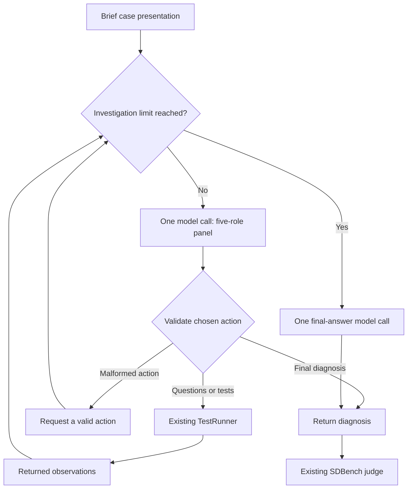

# Diagnostic agents, LangGraph, and tracing

This fork has two diagnostic strategies: Microsoft's released `baseline` and
our optional `experimental_panel`. The panel is a **paper-inspired experiment,
not the original MAI-DxO implementation**. It keeps the existing SDBench
gatekeeper, judge, case interface, and provider transport.

The original MAI-DxO code and complete prompts were not found in the public
release we checked. See the [source audit](mai_dxo_source_audit.json). An author
release would let us compare the actual implementation with this experiment;
the five role descriptions alone cannot establish equivalence.

## What each framework does

| Component | Responsibility in this project |
| --- | --- |
| SDBench | Case presentation, requested observations, diagnostic scoring, and clinical costing |
| Diagnostic agent | Decide what to ask or test, then submit a diagnosis |
| LangGraph | Execute the optional panel's stateful loop |
| Harbor | Run the containers, schedule trials, collect artifacts, and show results |
| Langfuse | Optional trace inspection; it does not run the diagnostic workflow or replace the judge |

LangGraph does not require LangChain model wrappers. Its nodes can call ordinary
Python functions, so the panel uses the supplied SDBench `agent_llm` callable.
This preserves the existing model deployment, response handling, and usage
metering. [LangGraph overview](https://docs.langchain.com/oss/python/langgraph/overview)

## The implemented panel

The [panel module](../sdbench/agents/experimental_panel.py) implements SDBench's
existing [diagnostic-agent interface](../sdbench/agents/__init__.py):

```python
run(case_summary, test_runner, agent_llm, collector, config) -> str
```

It receives a brief presentation, a callable for requesting observations, and a
callable for model inference. It never needs the patient's full case or reference
diagnosis. It uses the released baseline's XML action parsers rather than defining
a second tool protocol.



The five roles are perspectives inside **one model response per panel step**:

| Role | Our prompt asks it to do |
| --- | --- |
| Hypothesis | Maintain up to three plausible diagnoses and update them from observations |
| Test-Chooser | Select questions or up to three discriminating tests |
| Challenger | Look for contradictory evidence and premature closure |
| Stewardship | Prefer less costly or invasive choices when diagnostically equivalent |
| Checklist | Check the evidence and validity of the action |

There are no five additional servers or five mandatory model calls. The graph's
dispatch node is ordinary code. It sends one batch of requests to SDBench and
passes the returned observations back to the model.

The paper describes one model simulating five personas, but does not publish
enough orchestration code to infer its exact call boundaries. Our single-call
panel is an explicit implementation choice. Our newly written prompt does not
implement calibrated Bayesian probabilities or reproduce an unpublished stopping
threshold. It asks for a brief evidence-based summary, not hidden model reasoning.
[Official supplementary methods](https://www.science.org/doi/suppl/10.1126/science.aeh7930/suppl_file/science.aeh7930_sm.pdf)

Only the **unconstrained clinical-budget** variant is implemented. There is no
numerical medical budget tracker, ensemble, cost-based test cancellation, or
claim to reproduce the paper's accuracy-cost frontier. SDBench's test-turn limits
still apply. A separate `max_panel_calls` limit prevents malformed responses from
looping forever; one final-answer call is reserved beyond that limit. The default
is twice the runner's maximum turns, with a minimum of one panel call.
The isolated client additionally caps panel calls at `max_model_calls - 1`,
reserving that last allowed call for a final answer. Preparing a panel task
requires at least two allowed model calls. Provider call limits remain enforced
by the trusted service.

The collector records the prompt hash and implementation label in
`agent_metadata`, visible model messages in `agent_messages`, and actual graph
events in `graph_events`. A logical role is not recorded as a separate inference
call when no such call occurred.

## Reuse Harbor's existing interfaces

The current [Harbor adapter](../sdbench/harbor_integration/agent.py) extends
`BaseInstalledAgent`, runs the diagnosis client inside the task environment, and
writes a native ATIF trajectory. The [diagnosis client](../sdbench/isolation/diagnosis.py)
reaches the private case only through the role-bound service interface.

```text
Harbor trial
  |
  +-- diagnosis container
  |     baseline OR experimental panel
  |       +-- model calls ---------> trusted metered model endpoint
  |       +-- observation requests -> gatekeeper service
  |       +-- final diagnosis ------> service finalization
  |
  +-- gatekeeper container
  |     private case + released gatekeeper + authoritative event/usage records
  |
  +-- separate verifier container
        finalized evidence + reference answer -> released judge -> result
```

These are Docker container boundaries with a shared kernel. LangGraph state
fields are not a security boundary; the graph does not contain the gatekeeper
or judge. The diagnostic model receives only the presentation and disclosed
observations, regardless of how many logical roles its prompt describes.

Harbor **0.24.0 already includes a native LangGraph agent** that loads a graph
from `langgraph.json`. It is worth reusing for general graph projects. This fork
keeps its existing adapter because it also enforces the case-access and model
metering boundary and exports the diagnostic transcript. The native integration
can forward provider credentials into the agent container; selecting it without
review would change that boundary. It is not automatically equivalent to this
adapter. [Pinned Harbor LangGraph source](https://github.com/harbor-framework/harbor/blob/v0.24.0/src/harbor/agents/installed/langgraph.py),
[custom-agent interface](https://docs.harborframework.com/agents/custom-agents)

The existing [trajectory exporter](../sdbench/harbor_integration/trajectory.py)
already represents executed requests and returned observations. Retain it rather
than building another results viewer. Native ATIF supports messages, actions,
observations, and metrics. A text-only diagnostic episode has no screen recording;
its useful replay is the ordered transcript.
[Harbor ATIF documentation](https://docs.harborframework.com/agents/atif)

Choose the policy with `--diagnostic-agent baseline` or
`--diagnostic-agent experimental_panel` when preparing a task. This choice is
part of the frozen experiment configuration and protocol hash. The service tells
the diagnosis client which packaged agent to load; the client cannot choose an
arbitrary module. Gatekeeper and judge settings stay the same across a paired
gatekeeper comparison.

For a complete mock panel run, start Docker and run these commands from the
repository root. The output directory must be new. This selects one bundled
synthetic case and creates two mock gatekeeper conditions; it makes no paid API
calls.

```bash
uv sync --python 3.12 --extra harbor --extra panel

uv run --extra harbor --extra panel python -m sdbench.cli.isolation prepare \
  --dataset synthetic --case-set all --case-id 0 \
  --diagnostic-agent experimental_panel \
  --max-turns 3 --max-model-calls 8 --api-mode mock \
  --output results/panel-demo

uv run --extra harbor --extra panel harbor run \
  --config results/panel-demo/job.json

uv run --extra harbor --extra panel python -m sdbench.cli.isolation summarize \
  --manifest results/panel-demo/manifest.json \
  --jobs results/panel-demo/jobs \
  --output results/panel-demo/summary.json

uv run --extra harbor --extra panel harbor view results/panel-demo/jobs
```

The mock judge deliberately returns a non-passing score. Successful execution
means the episode completes with a valid verifier result; it does not mean the
mock agent demonstrated diagnostic accuracy.

## Langfuse without changing the experiment

The [implemented post-run exporter](../sdbench/harbor_integration/tracing.py)
reads only the gatekeeper-owned usage ledger and the verifier's judge-API
ledger. It exports hashed technical references, role, API mode/status, call
counts, token usage, and recorded API latency when present. It excludes patient
records, model messages, test names, prompts, graph-event text, and clinical
scores. Model names are hashed as references rather than sent as catalogue model
identifiers. The full public diagnostic transcript remains available in Harbor's
native ATIF viewer.

This adds no model calls and cannot change the agent's decisions. Its timestamps
describe the export, **not the original execution waterfall**; original recorded
latency is separate metadata. It does not invent five persona traces from a
single model response or turn a metadata hash into a de-identification claim.

```text
Completed Harbor trial
  trusted usage ledgers -> local metadata preview -> optional Langfuse export
  public transcript    -> native Harbor ATIF viewer
```

Build a preview first. Without `--send`, the exporter makes no network calls and
does not require the Langfuse SDK:

```bash
uv run python -m sdbench.harbor_integration.tracing \
  --trial-dir <completed-harbor-trial-directory> \
  --output results/trace-preview.json
```

To submit metadata, configure `LANGFUSE_BASE_URL`, `LANGFUSE_PUBLIC_KEY`, and
`LANGFUSE_SECRET_KEY` in the host environment, install the optional `tracing`
extra, then add `--send` with a new output path:

```bash
uv run --extra tracing python -m sdbench.harbor_integration.tracing \
  --trial-dir <completed-harbor-trial-directory> \
  --output results/trace-sent.json --send
```

SDK submission and flushing are not proof that the server accepted a trace;
check the trace in the configured Langfuse instance. Re-exporting the same trial
can append observations to its trace, so send the reviewed export once.

For future live node traces, Langfuse has a standard LangChain/LangGraph
`CallbackHandler`, passed to `graph.invoke(..., config={"callbacks": [...]})`.
However, our raw SDBench callable is not a LangChain model. A graph callback alone
does not prove that all provider calls, retries, or token usage were captured.
Use the trusted provider ledger for those facts; explicit SDK observations can
describe its calls if live tracing is later added.
[Official Langfuse integration](https://langfuse.com/integrations/frameworks/langchain)

Do not initialize tracing credentials inside the diagnostic container just to
display results. A host-side exporter can read the authorized artifacts after a
run and send them to a configured endpoint. If full clinical text is needed for
review, the trace backend, access controls, retention, and export fields need the
same treatment as the source records. Self-hosting is supported; it does not by
itself establish approval to process patient data. Masking happens before export
and must cover metadata as well as inputs and outputs.
[Self-hosting](https://langfuse.com/self-hosting),
[masking](https://langfuse.com/docs/observability/features/masking)

Keep three separate measures visible:

1. **Clinical cost:** SDBench's estimated medical workup cost.
2. **API cost estimate:** observed token usage multiplied by a specified rate card.
3. **Actual amount paid:** provider billing reconciliation, which is not implemented.

The [accounting module](../sdbench/isolation/accounting.py) already separates these
concepts and preserves unknown usage. A trace UI's generic model-price estimate
does not turn into an Azure invoice amount. Reasoning tokens are a subset of
output tokens, and cached tokens are a subset of input tokens; neither should be
added twice.

## Versions and verification

Source and API review date: **2026-10-22**.

| Dependency | Compatibility decision |
| --- | --- |
| SDBench core | Python 3.11+; experimental module imports LangGraph lazily |
| Harbor | Existing repository pin: 0.24.0; Harbor runner uses Python 3.12 |
| LangGraph | Optional `panel` extra; the lockfile records the exact resolved version |
| LangChain | No separate high-level model wrapper required for this panel |
| Langfuse | SDK 4.18.0 for the inspected local server 3.159.0; match server and SDK majors |

Current Langfuse documentation describes Python SDK v5, requiring a compatible
v4 server (at least 4.59.0), and `langchain-core>=1` for its callback integration.
Its documented compatibility path for a v3 server uses Python SDK v4. Consult
the pinned environment rather than copying the newest quickstart blindly.
[SDK compatibility](https://langfuse.com/docs/observability/sdk/overview)

The deterministic [panel tests](../tests/test_experimental_panel.py) execute the
real compiled LangGraph with scripted model responses. They cover sequential
question/test requests, observation flow, turn exhaustion, bounded malformed
responses, ambiguous actions, and invalid final answers. They make no paid model
calls and use no patient data. Install the optional panel dependency before
running them; graph tests otherwise report a skip explicitly.

```bash
uv sync --extra panel
uv run python -m unittest discover -s tests -p test_experimental_panel.py -v
```

A complete synthetic Harbor smoke test additionally needs to verify container
startup, service access, finalization, independent judging, ATIF rendering, and
trace export. Passing that test establishes infrastructure connectivity for the
tested configuration. Clinical validity, leakage performance, and equivalence
to MAI-DxO remain separate research questions. Follow the existing
[Harbor experiment guide](HARBOR_EXPERIMENT.md) and [runbook](../RUN_SDBENCH.md)
for run configuration and interpretation.
