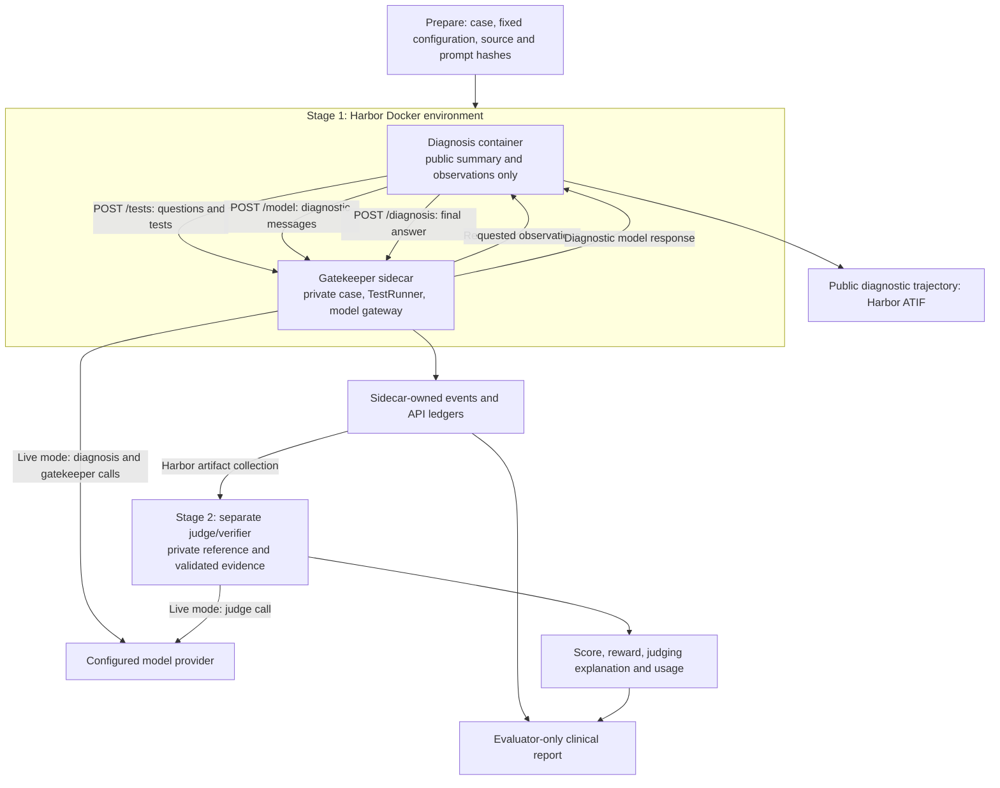

# Harbor architecture and commands

The adapter runs the released SDBench baseline behind a case-access boundary.
Its implemented paired experiment changes only the gatekeeper model. See the
[study plan](STUDY_PROTOCOL.md) for the proposed longitudinal cohort and other
comparisons, and [verification](VERIFICATION.md) for completed runs.

## Architecture

There are two execution stages. First, Harbor starts a diagnosis container and
a gatekeeper sidecar in one Docker environment. After the diagnostic agent stops,
Harbor collects the sidecar's evidence and starts the judge in a separate
verifier environment. All three role containers share the host kernel.



The gatekeeper *service* also meters diagnostic-model requests. That does not
mean the gatekeeper *model* sees the diagnostic model's entire conversation:
each role receives its own prompt and inputs. The server is a trusted process,
not a model with filesystem or administration tools.

The diagnostic process starts with `GET /session`, which returns the brief
`case_summary` and turn limit. It receives no reference diagnosis or full case.
Questions and test orders both use the existing `TestRunner`; the final answer
is finalized at the sidecar before the verifier accepts it.

### Source map

| Responsibility | Code used |
| --- | --- |
| Freeze paired trial identities, settings, and case hashes | [`ExperimentConfig`, `build_trial_configs`](../sdbench/isolation/experiment.py) |
| Generate distinct images, internal network, and separate verifier configuration | [`build_task`](../sdbench/harbor_integration/tasks.py) |
| Launch the diagnostic client through Harbor | [`SDBenchAgent`](../sdbench/harbor_integration/agent.py) |
| Adapt SDBench's diagnostic-agent and TestRunner interfaces to HTTP | [`RemoteTestRunner`, `run_diagnosis`](../sdbench/isolation/diagnosis.py) |
| Enforce the per-trial session and record authoritative events | [`TrialService`](../sdbench/isolation/service.py) |
| Supply clinical observations using upstream prompt templates | [`BatchTestRunner`](../sdbench/gatekeeper.py), [`prompts/`](../sdbench/prompts/) |
| Validate evidence, invoke the released judge, and write Harbor reward | [`grade_trial`](../sdbench/isolation/judge.py), [`check_diagnosis`](../sdbench/judge.py) |
| Record individual API attempts and distinguish usage from prices | [`providers.py`](../sdbench/isolation/providers.py), [`accounting.py`](../sdbench/isolation/accounting.py) |
| Export the public trajectory and evaluator's clinical report | [`trajectory.py`](../sdbench/harbor_integration/trajectory.py), [`reporting.py`](../sdbench/harbor_integration/reporting.py) |

## Role boundaries and evidence

Each task's `main` container contains source code, a session credential, and the
diagnosis client. It has no full case, reference diagnosis, clinical prompt YAML,
or provider key. The initial presentation comes from `GET /session`.

The gatekeeper sidecar owns `BatchTestRunner` and the private case. Its authenticated
API accepts only `/tests`, `/model` and `/diagnosis`, plus the read-only session.
The diagnostic credential cannot choose another case, model, provider, or role.
The service also hosts the trusted diagnostic-model metering endpoint; the
gatekeeper LLM has no server administration or filesystem tools.

The diagnosis and gatekeeper communicate on an internal Docker network. Only
the gatekeeper gets an additional outbound network in live mode. The mock judge
uses Docker's native `network_mode: none`; this works on Docker Desktop even
where Harbor's optional network-policy capability check rejects `no-network`.

After diagnosis ends, Harbor collects the **sidecar-owned** `/private/evidence`
directory. A separate verifier image receives it at the same absolute path.
The judge checks trial, case, configuration, event order, turn consumption, and
original-versus-accepted requests before making a judging call. Hashes detect
inconsistency; they are not authentication for arbitrary agent-authored files.
Trust comes from the sidecar source and Harbor's collection boundary.

The analysis accepts results only from verifier directories and API ledgers only
from the designated sidecar artifact or verifier locations. Agent artifacts with
similar filenames are ignored. Conflicting copies of a call ID are rejected.

Runtime source inventories, dependency pins, Dockerfile hashes, and the pinned
Python image are recorded in each task's `isolation.json`. Generated tasks, images,
and logs contain private case data and temporary credentials. Keep them local;
do not upload them to GitHub, a public registry, or Harbor Hub. Default paths are
under ignored `results/`.

## Existing framework contracts come first

The implementation was checked against the released SDBench source at
`304ce9625a046cea97d64e3b1ba5d19217b5095c` and the installed **Harbor 0.24.0**
schemas and lifecycle. Harbor requires Python 3.12; SDBench and the role images
remain compatible with Python 3.11.

| Responsibility | Existing implementation reused | Adapter addition |
| --- | --- | --- |
| Diagnostic reasoning | `sdbench.agents.baseline.run` and `DiagnosticAgent` protocol | Remote `TestRunner` and completion callable |
| Request filtering, turns, chunking, gatekeeper responses | `BatchTestRunner`, `order_tests`, packaged prompt YAML | Authenticated per-trial HTTP boundary |
| Diagnosis scoring | `check_diagnosis`, packaged judge prompt, 1–5 scale and ≥4 threshold | Finalized-evidence checks and strict output-format validation |
| Task execution | Harbor `BaseInstalledAgent`, `JobConfig`, Docker environment | Launch the existing diagnostic loop inside `main` |
| Scheduling, concurrency, retries, job identity/resume | Harbor jobs, plans and task-content locks | A prepared paired schedule; no custom worker scheduler |
| Separate judge and file transfer | Harbor separate verifier and sidecar artifacts | Dedicated judge image and explicit evidence selection |
| Trajectory and token display | Harbor native viewer, ATIF, `AgentContext` | Export public diagnostic messages/actions and provider-reported usage; protected ledgers also cover gatekeeper and judge |
| Medical test costing | Existing SDBench costing modules | Not executed by this initial adapter |

Relevant Harbor specifications: [custom agents](https://docs.harborframework.com/agents/custom-agents),
[multi-container tasks](https://docs.harborframework.com/tasks/multi-container),
[separate verifier](https://docs.harborframework.com/tasks/separate-verifier),
[artifacts](https://docs.harborframework.com/jobs/artifact-collection),
[jobs](https://docs.harborframework.com/jobs/run-a-job).
Installed 0.24.0 code/schema is authoritative when newer web documentation differs.

SDBench's `TestRunner` and injected `llm` interfaces provide the extension points
for both policies. The baseline path preserves its released reasoning loop and
clinical prompts. The experimental panel has its own disclosed diagnostic prompts.
The full in-process SDBench harness cannot be reused unchanged for the
three-role boundary because it holds the private case and collector beside the
diagnostic agent.

The remaining custom work is specific to this experiment: role-scoped transport,
protected evidence, fixed condition assignment, pairing by case/repetition, and
accounting for missing/failed attempts. Harbor's ordinary mean-reward metric does
not carry case identities needed for a paired case-level bootstrap.

### Runtime limits

Generated tasks allow 30 minutes for the diagnostic episode and 10 minutes for
the verifier. The HTTP client's per-request timeout matches the diagnostic episode
limit: one gatekeeper request can contain several chunks and formatting/provider
retries. Individual live provider attempts have a 120-second timeout. Harbor
controls total episode wall time. These limits can affect slower models; report
timeouts by arm and do not interpret infrastructure failures as clinical errors
without also reporting completed-only results. The primary scheduled denominator
still retains failures.

### Deliberate deviations from the original harness

- The adapter refuses ambiguous judge output instead of accepting the original
  parser's fallback to any score-range digit. This is the same rule in both arms,
  but means this is a controlled new experiment, not exact reproduction of all
  published scores.
- Live metering currently uses the existing OpenAI SDK directly, with SDK retries
  disabled and a fixed role-bound model. This is intentionally narrower than
  SDBench's OpenRouter/Azure/local routing: it makes each SDK attempt visible to
  the ledger. Existing SDBench gatekeeper formatting retries and its injected-LLM
  retry wrapper remain in use and each provider attempt is recorded. Provider
  routing must be held constant across both arms.
- The model-call limit also bounds malformed baseline responses that do not
  consume a test turn. It is part of the frozen experiment configuration.
- Synthetic provenance remains in private evidence for the judge; it is not
  exposed through the diagnostic agent's HTTP response.
- The three packaged prompt pairs are pinned experiment settings, checked against
  SDBench's `science` configuration in tests. This avoids executing ambient local
  config overrides during manifest creation. Synthetic smoke cases use the NEJM
  prompt pair, explicitly, rather than claiming a published synthetic benchmark.

## Run the mock experiment

Use the [README quickstart](../README.md#try-harbor-without-model-api-calls).
Preparation makes no model calls and refuses to overwrite a destination. The
mock judge deliberately returns 3/5 and reward 0. These are transport checks.
Each explicit repetition has a paired identity and the generated Harbor job sets
`n_attempts=1`; do not add Harbor attempts on top of `--repetitions`. Use Harbor's
job recovery with the original generated tasks.

## Paired experiment design

For each case and repetition, preparation creates two trials under one protocol
hash. The schedule is shuffled reproducibly. Pair identity is retained even
when execution fails, so failed trials cannot silently disappear from analysis.

| Setting | Arm A | Arm B |
| --- | --- | --- |
| Case, initial presentation, and repetition | Same | Same |
| Diagnostic policy/model and judge model | Fixed | Same |
| Gatekeeper model | `o4-mini` | `gpt-5` |
| Gatekeeper and judge prompts | Fixed per dataset | Same |
| Provider route, model arguments, turn/call limits | Fixed | Same |

The current paired configuration pins these upstream prompt versions:

| Dataset | Gatekeeper prompt | Judge prompt |
| --- | --- | --- |
| NEJM | `v6_fixed` | `v3_reasoning` |
| MIMIC | `v13_mimic` | `v4_reasoning_with_tests` |
| Synthetic smoke | `v6_fixed` | `v3_reasoning` |

The paired CLI currently accepts only those three datasets. A custom longitudinal
cohort needs explicit case preparation and protocol support; naming a new folder
does not make it an accepted paired experiment. Keep development cases separate
from a held-out evaluation set.

### Live execution and interpretation

Prepare with `--api-mode live` only when the model choice, case access, and spending
plan are settled. The paired direct-OpenAI worker requires an exported `OPENAI_API_KEY`; do not put
keys in manifests, prompts, images, or chat. Only gatekeeper and judge receive the
provider credential. Both arms retain the same diagnostic and judge models,
prompts, API route, limits, and model arguments. Only the gatekeeper model differs.

The default shared `max_completion_tokens` is 4096. It is configurable and stored
in the manifest. Validate model availability and common supported settings before
the full run. Mock smoke tests do not verify paid API availability or clinical
correctness. A successful live smoke run verifies that particular configured
deployment and transport; it does not establish clinical correctness in general.

The optional `--rate-cards PATH` accepts a JSON object keyed by exact model name.
Each entry has `effective_date` (YYYY-MM-DD), `input_per_million`,
`output_per_million`, optional `cached_input_per_million`, and optional `source`.
No prices are guessed. Reported cached-input and reasoning tokens are subsets,
not extra tokens added again. Failed calls without usage retain unknown cost.
Token-rate estimates are not invoice-confirmed charges; `actual_paid_usd` remains
null until a separate provider-billing reconciliation is implemented.

Results retain failed and missing scheduled episodes in the primary denominator,
also show completed-only accuracy, and calculate paired differences at the case
level. NEJM and MIMIC are reported separately. Missing audit labels remain unknown;
the software does not invent a semantic leakage score.

The comparison measures the gatekeeper's effect on the whole interactive
workflow: changed observations can change subsequent requests. Fixed-request
replay would be a separate experiment. Semantic disclosure is not inferred from
container isolation or the gatekeeper's synthetic flags; missing audit labels
remain unknown.

## Live Azure smoke test

`prepare-smoke` makes one bounded encounter using a bundled synthetic case and
the same explicitly selected deployment for diagnosis, gatekeeper and judge.
This is **not** the paired `o4-mini`/`gpt-5` experiment. It does not recreate
MAI-DxO or establish clinical performance.

Use your verified Azure resource endpoint and deployment name. For example,
replace `<resource>` and `<tenant-id>` below with your resource and tenant:

```bash
uv run --extra harbor python -m sdbench.cli.isolation prepare-smoke \
  --model gpt-5.4 \
  --base-url https://<resource>.cognitiveservices.azure.com/openai/v1/ \
  --case-id 0 --max-turns 5 --max-model-calls 8 \
  --max-completion-tokens 4096 --reasoning-effort medium \
  --jobs results/harbor-dashboard/jobs --output results/azure-gpt54-smoke

uv run --extra harbor python -m sdbench.cli.azure_harbor \
  --tenant <tenant-id> --config results/azure-gpt54-smoke/job.json

uv run --extra harbor harbor view results/harbor-dashboard/jobs \
  --host 127.0.0.1 --port 8080-8089 --jobs
```

The launcher delegates the entire job to `harbor run`. It uses your existing
`az login` to acquire a short-lived Entra token, refreshes it before expiry, and
removes its private temporary directory when the run ends. Docker Compose mounts
that directory read-only into gatekeeper and judge. Diagnosis receives neither
the provider credential nor your Azure login cache. Credentials are not placed
in task configs, images, process arguments, or run artifacts.

The Azure adapter uses the existing OpenAI SDK's Responses API with `store=False`
and SDK retries disabled. It maps the returned text into SDBench's existing
completion interface and preserves the original response and usage in the
protected ledger. When Responses supplies message phases, only `final_answer`
text is actionable; intermediate `commentary` is retained in raw evidence.
Retained assistant answers are replayed with `phase: final_answer`, so progress
messages cannot accidentally trigger duplicate clinical requests. The exact
Responses input is also logged. Each call resends SDBench's text history; no hidden reasoning
state or `previous_response_id` is carried between calls. Responses token caps
include reasoning tokens as well as visible output.

Open the job and then its trial in the viewer. The native trajectory shows the
diagnostic agent's conversation, test requests, observations and final diagnosis.
The protected `artifacts/gatekeeper-evidence/raw_calls.jsonl` and
`verifier/raw_calls.jsonl` retain gatekeeper and judge prompts and responses for
local inspection. The verifier result contains the grade and judging explanation.
This is a text/action trace, not a screen recording or access to hidden model
reasoning. The diagnostic agent never receives those privileged artifacts.

Harbor's agent token display covers diagnostic calls; all-role provider usage is
in `artifacts/gatekeeper-evidence/usage.jsonl` and
`verifier/judge_api_calls.jsonl`. Requested deployment names and returned model
identities are both retained. Azure dollar cost remains unknown without an
applicable rate card/billing reconciliation. Do not apply public OpenAI prices
to Azure charges automatically. Harbor 0.24's native token-chart tooltips may
independently show generic LiteLLM catalog estimates even when our saved cost
fields are unset; those are not Azure invoice amounts. Also capture the Azure
deployment's current model version and upgrade policy: a named deployment can
auto-upgrade even when its current version has a dated identifier. The paired `summarize` command intentionally
rejects this single-model smoke manifest.

## Viewing results and reports

- **Pareto** defaults to API cost versus reward. A trial with unknown `cost_usd`
  has no point on that axis. Tokens or time can be selected instead. This is not
  the paper's clinical-workup cost plot.
- **Outcomes** represents each trial as a small square. One completed case
  produces one square, not a clinical encounter report.
- **Trajectory** shows the diagnostic agent's messages and actions. A text-only
  encounter has no screen video: no browser or computer-use episode was recorded.
  Neither hidden model reasoning nor unimplemented MAI-DxO role debates can be
  reconstructed from this trace.
- **Verifier / Artifacts** retain privileged audit evidence. The native file
  viewer has a 1 MiB text limit; a large raw-call ledger can fail to open despite
  existing on disk. Do not interpret that display failure as a missing run.

The existing SDBench HTML renderer is the clinical report interface to reuse:
it already shows diagnostic, gatekeeper, and grader conversations, the reference
diagnosis, and gatekeeper-reported observation flags. These flags do not independently verify source provenance. Reports containing privileged case evidence
belong on the evaluator side and must never be mounted into the diagnostic agent.

After a trial finishes, export its saved evidence without making new model calls:

```bash
uv run --python 3.11 python -m sdbench.harbor_integration.reporting \
  --trial-dir <completed-harbor-trial-directory> \
  --case <prepared-task-directory>/tests/private/case.json
```

This verifies the case and evidence hashes and writes
`artifacts/clinical-report/overview.html`, mapped results, and an audit manifest.
The export preserves the original ledgers and creates per-call copies small
enough for Harbor's file viewer. Open the HTML in a browser to use the existing
Agent Dialog, Grader Dialog, Gatekeeper Dialog, and Test Runner Log controls;
Harbor's file browser displays HTML source rather than rendering the page.
The notice distinguishes fictional cases, incomplete attempts, unknown API
dollars, and clinical costs that have not been computed. The summary percentage
describes only the saved encounter(s), not population performance.

### Inspecting a failed encounter

The completed clinical report intentionally requires a submitted diagnosis and
valid judge result. A failed encounter may have neither; do not fill them with
default answers. The partial public conversation is not currently retained in
`agent/diagnosis.json`, which records sanitized status and error type on failure.
Inspect the protected artifacts instead:

- `artifacts/gatekeeper-evidence/events.jsonl`: completed requests/observations and
  any terminal event.
- `artifacts/gatekeeper-evidence/raw_calls.jsonl`: recorded diagnostic and gatekeeper
  attempts, including available prompts, responses and failures.
- `verifier/result.json` and `verifier/raw_calls.jsonl`, if produced: grading status
  and judge attempts.
- The trial's `result.json`: Harbor execution and exception status.

A polished failed-encounter report remains unimplemented. Missing records must be
reported as missing; the raw logs are evidence, not a reconstructed success.
